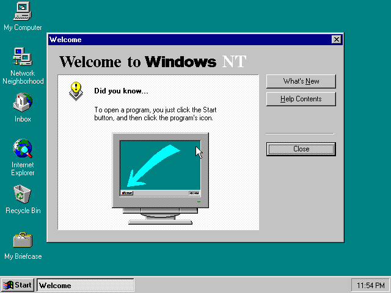

# powermac-nt-hal — Windows NT 4.0 on the Apple Network Server

[](https://github.com/pappadf/powermac-nt-hal/actions/workflows/build.yml)
[](LICENSE)

> [!CAUTION]
> **Experimental, and not supported by Apple. Do not run this on a real Mac you care about.**
> Apple never supported Windows NT on the Network Server, and this project has only been tested
> in the [granny-smith](https://github.com/pappadf/granny-smith) emulator, never on real
> hardware. It drives the processor, the PCI bridges, the SCSI controllers, the power controller
> and the disks itself, in ways Apple never designed or tested. A bug in it could, in theory,
> damage the hardware, and it can destroy the data on any disk it can reach: Setup partitions and
> formats disks. It comes with no warranty (see the [licence](LICENSE), GPL-2.0 sections 11–12).
>
> **It changes no NVRAM setting.** Earlier versions stored `little-endian? true` in Open
> Firmware's NVRAM, a setting Apple never supported that has been
> [reported](https://discussions.apple.com/thread/1085726) to leave machines needing an NVRAM
> reset (at least one could not be recovered). The floppy now leaves the firmware in its factory
> big-endian mode and switches the processor and the PCI bridges to little-endian itself, until
> the next reset. If an earlier floppy's `setup.of` was ever run on a machine, run `restore.of`
> on it once (below) to put the factory values back.

*This exists because of [`entii-for-workcubes`](https://github.com/Wack0/entii-for-workcubes) and
[`maciNTosh`](https://github.com/Wack0/maciNTosh) by **Wack0 (Rairii)**, and
[`maciNTosh-bandit`](https://github.com/MCJack123/maciNTosh-bandit) by **MCJack123**. Reading
their code is how this HAL knows what it knows. Thank you.*

A hardware abstraction layer (`HALSHINR.DLL`) and an ADB keyboard/mouse driver (`ADBPORT.SYS`)
that let **Windows NT 4.0 for PowerPC** install and run on the **Apple Network Server 500/700**,
a machine Apple never supported NT on and Microsoft never shipped a HAL for. Both are built from
source with `clang` and `lld`; there is no Microsoft tool, header or DDK in the build.



**What works.** From a cold machine and a **stock, unmodified** NT 4.0 Workstation CD, text-mode
and GUI Setup complete, and the installed system cold-boots through this project's own ARC
firmware to its logon screen and takes Ctrl+Alt+Del from the ADB keyboard. Both Symbios 53C825A SCSI controllers, the Cirrus 54M30 at
640×480×256 through NT's own display driver and the chip's BitBLT engine, the ADB keyboard and
mouse through Cuda, the real-time clock, and NT's restart all work. The emulator project's
integration tests do the whole install unattended.

**Nothing of Microsoft's is on the floppy.** Both boots, the install from the CD and the
installed system, go through this project's own ARC firmware (`src/arcfw`,
[`docs/2026-11-05-the-arc-firmware.md`](docs/2026-11-05-the-arc-firmware.md)); the veneer off
the CD, which earlier builds patched and carried, is gone. A built floppy is GPL-2.0-only and may
be shared, and [the releases](https://github.com/pappadf/powermac-nt-hal/releases) carry one.

**What does not, yet.** Networking: there is no adapter driver, and GUI Setup is told not to
participate. Real hardware: nothing has been tried outside the emulator.

## Using it

Three ingredients, none of which can ship here: a **Network Server ROM** (the production
1.1.22 ROM every machine shipped with, or the 2.26NT one Apple built for NT; since 6 November
2026 either works), a **Windows NT 4.0 Workstation for PowerPC CD image** with its Product ID, and the
[Granny Smith](https://github.com/pappadf/granny-smith) emulator. The floppy itself needs none of
them: build it, or take it from a release.

```bash
make                                       # -> build/hal.dll, build/adbport.sys, build/arcfw.xcf
make floppy                                # -> build/boot-floppy.img
make disk                                  # -> build/nt-disk.img
```

Then, on an emulated Network Server 500 with 64 MB, the CD at SCSI id 0 on the first controller,
the disk at id 0 on the second and the floppy in the drive, at the Open Firmware `0 >` prompt:

```forth
load fd:,\boot.of          \ to install from the CD
load-base loadsize eval

load fd:,\bootdisk.of      \ to start what you installed
load-base loadsize eval
```

Nothing to configure first: the firmware stays as it left the factory. Only on a machine where an
earlier version's `setup.of` was run, once, to restore the factory NVRAM values:

```forth
load fd:,\restore.of       \ it resets at the end
load-base loadsize eval
```

**[`docs/HOWTO.md`](docs/HOWTO.md) is the whole walk**, every Setup screen and the key it
takes, including the three that are not Enter. [`docs/EMULATOR.md`](docs/EMULATOR.md) sets the
emulator up.

Needs `clang-18`, `lld-18` and `python3`. The build is reproducible: two builds of the same tree
are byte-identical.

### How it fits together

The floppy is **not** the boot device. Open Firmware reads this project's ARC firmware
(`ARCFW.XCF`) off it as raw blocks and starts it with its own `xcoff-loader`; the firmware gives NT's loaders the ARC interface they expect
over Open Firmware's client interface, loads SETUPLDR off the CD as pressed (or OSLOADER off the
installed disk), and no Microsoft code runs before NT's loader. Setup
then meets the same floppy as an ordinary manufacturer's support disk and takes from it the HAL
(*Apple Network Server 500/700*) and the ADB driver. NT has no driver for
the floppy drive, so `boot.of` reads the whole floppy into RAM first and the ADB driver serves it
to Setup's copy phase from there. The 54M30, the two 53C825As and the Cuda clock are driven by
NT's own `cirrus.sys`, `symc810.sys` and this HAL.

> ### The floppy image may be redistributed
>
> Everything on it is this project's: `ARCFW.XCF`, `HALSHINR.DLL`, `ADBPORT.SYS`, a
> `txtsetup.oem` and three Open Firmware scripts, all GPL-2.0-only, all built from this tree by
> `make floppy` with nothing taken from any CD. SETUPLDR and NT's own drivers stay on your CD,
> where the firmware and Setup read them. Floppies built before 5 November 2026 carried
> Microsoft's veneer off the CD and could not be shared. [`PROVENANCE.md`](PROVENANCE.md) has
> the policy and every row behind it.

## Releases

A tag `v*` runs [`release.yml`](.github/workflows/release.yml): it builds everything, lays out
the floppy, checks that nothing of Microsoft's is on it and that it rebuilds byte for byte, and
publishes the image, the binaries and their checksums as a GitHub Release and on GitHub
Pages (with this HOWTO; the repository's Pages source must be set to *GitHub Actions* once).
Every release keeps its own page for good: `https://pappadf.github.io/powermac-nt-hal/v1.0/`
stays v1.0's, with that tag's HOWTO and files, after v1.1 or v2.0. The root shows the newest
release and lists them all, and `download/` keeps every release's versioned files at the
addresses v1.0 first published them under. Each deployment rebuilds the whole site from the
Releases and the tags (`tools/mkpages.py`), so nothing depends on an earlier deployment.
Every push builds the same floppy as a CI artifact ([`build.yml`](.github/workflows/build.yml)).

## What is here

| | |
|---|---|
| [`src/`](src/), [`include/`](include/) | the HAL: Grand Central interrupt dispatch, Bandit PCI configuration and address translation for both bridges, decrementer clock, Cuda transport (ADB, RTC, restart), ESCC and 54M30 consoles, the partition-table and drive-letter exports NT puts on the HAL side, and the OEM-disk hand-off |
| [`drivers/adbport/`](drivers/adbport/) | the NT port driver: keyboard and pointer ports over the HAL's ADB callback, and the RAM floppy as `\Device\Floppy0` |
| [`tools/`](tools/) | ELF-to-PE conversion, descriptor and thunk stubs, the floppy and disk builders, COFF and PE disassemblers, FAT readers and writers ([index](tools/README.md)) |
| [`docs/`](docs/) | [how to run it](docs/HOWTO.md), the emulator setup, the session write-ups with their evidence, and the project's history ([index](docs/README.md)) |
| [`traces/`](traces/) | a screenshot of every Setup screen reached, and the console transcripts the write-ups quote |
| [`PROVENANCE.md`](PROVENANCE.md), [`NOTICE`](NOTICE) | every borrowed fact, its origin and its licence; whose work this builds on |

## The story

The Network Server is a **TNT-class** machine, a Power Macintosh 9500 logic board with server
changes: Hammerhead, two Bandit PCI bridges, Grand Central, Cuda over a VIA. Most of the HAL is
about that family; the machine-specific part is a short list in `include/ans.h`. Nothing has
been tried on a desktop 7500/8500/9500, which have no ARC firmware of their own.

**[`docs/STORY.md`](docs/STORY.md)** is every wall hit on the way, 51 of them, and what each
turned out to be. A few worth reading whatever you work on: the interrupt that never arrived
was a stubbed `HalAllocateAdapterChannel`; an eight-byte return value comes back through a
hidden pointer in `r3` on this ABI; *"could not load the keyboard layout file"* was a machine
with no drive letters; the SVR4 LR save slot is where NT keeps the caller's TOC; and the
compiler put a misaligned access back twice, each time an alignment exception on a
little-endian 604. The dated write-ups in [`docs/`](docs/README.md) carry the evidence.

## Borrowed parts

**[`NOTICE`](NOTICE) is the attribution document**: which upstream taught which file, at which
commit, under which licence. [`PROVENANCE.md`](PROVENANCE.md) is the log behind it, one row per
borrowed thing, added when it was borrowed, with its extent. Nothing here was copied from either
upstream; both are recorded as *rewritten from reading*, and that is still a derivation, which
is where the licence comes from.

`entii-for-workcubes`' `halartx` is the HAL this one learned its shape from: who owns the IRQL,
which phase does what, which routines may be stubs. `maciNTosh` and `maciNTosh-bandit` are where
the Cuda handshake and the three-function HAL-to-driver ADB contract come from; the keyboard
once ran on `maciNTosh`'s `usbadb.sys`, a binary this project could run but not redistribute,
and [`drivers/adbport/`](drivers/adbport/) replaced it.

Nothing in this repository is derived from leaked Windows NT source. Everything came from the
DDK-documented `Hal*` contract, the shipped binaries' own COFF symbol tables, observed behaviour
under a debugger, and hardware documentation. See [`CONTRIBUTING.md`](CONTRIBUTING.md).

## A note on AI

This project allows the use of AI, for code, review and documentation alike. There is no
commitment to track, at the file or commit level, which code was written with AI assistance and
which was not. I know that AI may be a red flag for some people, and I fully respect that.

## Licence

**GPL-2.0-only**, see [`LICENSE`](LICENSE). This is not a preference; it follows from the
provenance log, because the HAL's structure was derived by reading GPL-2.0 sources. Every file
carries `SPDX-License-Identifier: GPL-2.0-only` and `Copyright (C) 2026 powermac-nt-hal contributors`;
[`AUTHORS`](AUTHORS) says who those are, [`NOTICE`](NOTICE) says whose work this builds on.

Windows NT, Microsoft, Apple, Power Macintosh, Symbios and Cirrus Logic are trademarks of their
respective owners, used here descriptively to say what this software is compatible with. This
project is not affiliated with, authorised by or endorsed by any of them.

## Credits

- The **TinkerDifferent** thread [*"Apple Network Server: MacOS-based ROMs
  found"*](https://tinkerdifferent.com/threads/apple-network-server-macos-based-roms-found.4756/):
  Mr. Macintosh, who got NT's Setup onto a real ANS 700 with a serial console and posted the
  transcript; ClassicHasClass, for the ROM dumps and the write-ups; joevt, for the ROM analysis
  and the detokenized firmware.
- **Wack0 / Rairii**: [`entii-for-workcubes`](https://github.com/Wack0/entii-for-workcubes),
  [`maciNTosh`](https://github.com/Wack0/maciNTosh), and `peppc`.
- **MCJack123**: [`maciNTosh-bandit`](https://github.com/MCJack123/maciNTosh-bandit), the port
  of that ARC firmware to Bandit-class Power Macs, which is what put the Cuda/ADB code on this
  machine's hardware.
