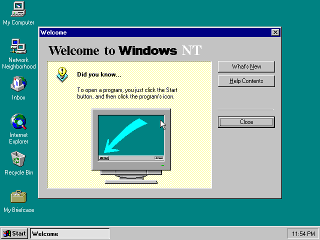

<!-- SPDX-License-Identifier: GPL-2.0-only -->
<!-- Copyright (C) 2026 powermac-nt-hal contributors -->

# Installing Windows NT 4.0 on an Apple Network Server, start to finish

Every key you press, from a cold machine to the Windows NT logon screen. About forty minutes of
wall-clock time on an emulated machine, most of it NT copying files. Nothing is written to your
CD image at any point.

## 0. What you need

| | |
|---|---|
| **The emulator** | [Granny Smith](https://github.com/pappadf/granny-smith), `main`, built with `make headless` (or `make run` for the browser). [`EMULATOR.md`](EMULATOR.md) is the setup page |
| **A Network Server ROM** | Either one. The **production 1.1.22 ROM** (`ans500-ans700-962f6c13.rom`, the one every Network Server shipped with) works since 6 November 2026: this project's firmware no longer depends on anything the NT ROM added. The **Open Firmware 2.26NT ROM** (MD5 `ad405e01c663340c479668c70f741f1b`, from the [TinkerDifferent thread](https://tinkerdifferent.com/threads/apple-network-server-macos-based-roms-found.4756/)) works as before. Section 8 says what differs |
| **A Windows NT 4.0 Workstation for PowerPC CD image** | OEM 000-48303, October 1996, MD5 `ab37556d72818ed082c1d01c2d7f1898`. It is read, never written |
| **Its Product ID** | the digits on the Certificate of Authenticity. GUI Setup will not continue without one |
| `clang-18`, `lld-18`, `python3` | to build this repository. No Microsoft tool, header or DDK |

## 1. Build the floppy and the disk

```bash
make floppy                               # -> build/boot-floppy.img
make disk                                 # -> build/nt-disk.img, 512 MB
```

`make floppy` compiles the HAL, the ADB driver and the ARC firmware and lays them out, with a
`txtsetup.oem` and three Open Firmware scripts, as a 1.44 MB FAT12 image of seven files. Nothing
on it comes off the CD; it is GPL-2.0-only and may be shared, and every
[release](https://github.com/pappadf/powermac-nt-hal/releases) carries one. The build is
reproducible: the same tree gives a byte-identical floppy.

`make disk` writes an empty disk with the one thing Setup insists on before it will start: an
ARC *system partition*, 32 MB of FAT at the front, which on a real ARC machine `ARCINST.EXE`
would create. Install to the **second** partition; the first is where the firmware reads
`OSLOADER.EXE` and `HAL.DLL` from.

Rebuild the floppy whenever you rebuild the HAL, the ADB driver or the ARC firmware: the copies
on the floppy are the ones Setup and the disk boot load.

## 2. Configure the machine

| | |
|---|---|
| Model | Network Server 500 (`model=ans500`) |
| ROM | the production 1.1.22 ROM or the 2.26NT ROM |
| RAM | **64 MB**. Not the 32 MB default; see below |
| CD | your NT CD at SCSI **id 0** on the **first** fast/wide controller (`/bandit/53c825@11`) |
| Disk | `nt-disk.img` at SCSI **id 0** on the **second** controller (`/bandit/53c825@12`) |
| Floppy | `boot-floppy.img` in the internal drive |

Headless:

```bash
./build/headless/gs-headless --speed=turbo rom=<ans500-ans700.rom> model=ans500 ram=65536 \
      drive=scsi:0:cd:/path/to/nt4-ppc.iso drive=scsi2:0:hd:/path/to/nt-disk.img \
      fd0=/path/to/boot-floppy.img
```

In the browser, set RAM to 64 MB and attach the three images; the defaults put the CD and the
disk at the right ids.

**The ids are hardcoded** in the floppy's scripts: `boot.of` points the firmware at
`/bandit/53c825@11/sd@0,0` and `bootdisk.of` at `/bandit/53c825@12/sd@0,0`. A CD anywhere else
gets you to the firmware and then `arcfw: fatal: cannot load '...\PPC\SETUPLDR'`.

**RAM is not negotiable.** `boot.of` reads the whole floppy into RAM at 59 MB for NT
(`include/oemdisk.h`), so the machine needs 64 MB.

## 3. The firmware: two lines

Cold-boot. The firmware tries its default device, fails, and stops at `0 >`. That failure is
normal.

There is nothing to configure: the firmware stays in its factory big-endian mode and nothing is
stored in NVRAM. `ARCFW.XCF`'s first stage (`src/stage0`) switches the processor and the PCI
bridges to little-endian itself, until the next reset. (Earlier versions had a `setup.of` that
stored `little-endian? true` and the load addresses in NVRAM. On a machine where it was run,
`boot.of` says so and stops; run `restore.of` the same way once, and the machine resets with the
factory values back.)

**To install:**

```forth
load fd:,\boot.of
load-base loadsize eval
```

You should see the firmware load, the floppy read into RAM, and SETUPLDR start off the CD:

```
tsize=F000 dsize=1000 bsize=95000 entry=60EC90
SECTIONS:
.text    00600000 00600000 0000F000 000000D4
.data    0060F000 0060F000 00001000 0000F0D4
.bss     00610000 00610000 00095000 00000000
loading .text, done..
loading .data, done..
clearing .bss, done..
powermac-nt-hal: reading the OEM disk into RAM (this takes a while) .........
powermac-nt-hal: B40 blocks of the OEM disk are in RAM
powermac-nt-hal: starting Windows NT Setup

stage0: powermac-nt-hal, Open Firmware in its factory big-endian mode
stage0: RAM 0x04000000
stage0: Bandit at 0xF2000000
stage0: Bandit at 0xF4000000
stage0: device tree taken, 0x00000033 nodes, 0x00007700 bytes
stage0: switching to little-endian mode (until the next reset)

Arcfw 0.1: ARC firmware for the Apple Network Server (powermac-nt-hal)
arcfw: little-endian since stage0; Open Firmware left in its factory mode, nothing in NVRAM changed
arcfw: system parameter block at 4000, 37 vector entries
arcfw: configuration tree built
arcfw: booting 'multi(0)scsi(0)cdrom(0)fdisk(0)\PPC\SETUPLDR'
arcfw: loaded at 80600000..80647200, entry descriptor 80641aac
arcfw: starting the loader
```

From `stage0:` on, everything is on the serial console (ttya) only: Open Firmware is gone, and
the ARC firmware drives the ESCC itself.

then SETUPLDR's blue *Windows NT Setup* screen on the serial console.

The comma after `fd:` is required: Open Firmware reads what follows `:` as a partition number.
`dir fd:,\` lists the floppy if you want to check the drive is live first.

## 4. Text-mode Setup

The first screens come through the firmware onto the serial console and the screen alike; from
the kernel onward Setup draws on the monitor and takes the ADB keyboard.

| Screen | Press |
|---|---|
| **Select the computer type** | ↓ to **Other**, Enter. Enter again for the support disk (the floppy is already in). One entry is offered, **Apple Network Server 500/700**: Enter |
| **Mass storage** | the step everyone skips. **S**, then **Other**, Enter, and pick **Apple Desktop Bus keyboard and mouse, and the OEM disk (powermac-nt-hal)**. The list then shows two devices: Enter |
| **Video adapter** | **↑ twice** from *Other* to **Motorola Power Stack (cirrus 54xx)**, the CD's own entry, Enter. (Floppies built before 5 November 2026 offered *Cirrus Logic 54M30 (Apple Network Server 500/700)* under **Other** instead, carrying a patched driver; the HAL no longer needs it) |
| **Welcome to Setup** | Enter |
| **Mass storage (NT's own list)** | Enter |
| **Licence** | Page Down **eighteen times**, then **F8** |
| **Hardware list** | should read *Apple Network Server 500/700*, the Cirrus Logic display you chose, *XT, AT, or Enhanced Keyboard*. Enter |
| **Partitions** | ↓ twice to **D:**, the 478 MB partition. Enter. Never C:, the system partition |
| **File system** | Enter on *Leave the current file system intact*. **Not NTFS**: the firmware reads FAT only, and the installed system boots from it |
| **Directory** | Enter for `\WINNT` |
| **Disk examination** | **Esc** to skip it |
| **Copying** | ten to fifteen minutes |
| **This portion of Setup has completed successfully** | Enter. NT restarts the machine through Cuda and the firmware comes back to `0 >` |

Why the mass-storage step matters: SETUPLDR takes your keystrokes through the firmware, so
everything works until NT's own keyboard stack starts, which is several screens later. The ADB
driver is what gives NT a keyboard, and `[SCSI]` is the one class SETUPLDR loads arbitrary
drivers for. Skip it and Setup dies with *"Setup did not find a keyboard connected to your
computer"*, which is unrecoverable. The same driver serves the floppy image in RAM to the copy
phase, since NT has no driver for the real drive.

## 5. GUI Setup and the logon screen

Back at `0 >`, with the same floppy in the drive:

```forth
load fd:,\bootdisk.of
load-base loadsize eval
```

`bootdisk.of` loads this project's ARC firmware (`ARCFW.XCF`, built from `src/arcfw` and loaded
by the ROM's own `xcoff-loader`; no Microsoft code runs before NT's loader), sets the ARC environment for this boot, and points the
firmware at the disk. `Arcfw 0.1` reports what it found (it asks only SCSI target 0 and the
targets the boot variables name; `setenv ARCFW-SCSI-TARGETS all` at the prompt makes it scan
every id, at a selection timeout for each absent one), OSLOADER's menu shows *Windows NT
Workstation Version 4.00*, the kernel loads, the HAL comes up, and after `autochk` the Setup
wizard is drawn:

```
tsize=F000 dsize=1000 bsize=95000 entry=60EC90
SECTIONS:
.text    00600000 00600000 0000F000 000000D4
.data    0060F000 0060F000 00001000 0000F0D4
.bss     00610000 00610000 00095000 00000000
loading .text, done..
loading .data, done..
clearing .bss, done..
powermac-nt-hal: starting the installed Windows NT

stage0: powermac-nt-hal, Open Firmware in its factory big-endian mode
stage0: RAM 0x04000000
stage0: Bandit at 0xF2000000
stage0: Bandit at 0xF4000000
stage0: device tree taken, 0x00000033 nodes, 0x00007800 bytes
stage0: switching to little-endian mode (until the next reset)

Arcfw 0.1: ARC firmware for the Apple Network Server (powermac-nt-hal)
arcfw: little-endian since stage0; Open Firmware left in its factory mode, nothing in NVRAM changed
arcfw: system parameter block at 4000, 37 vector entries
arcfw: configuration tree built
arcfw: booting 'multi(0)scsi(1)disk(0)rdisk(0)partition(1)\os\winnt40\osloader.exe'
arcfw: loaded at 80600000..8064a800, entry descriptor 80643d38
arcfw: starting the loader
OS Loader V4.00
```

`setenv ARCFW-DEBUG 7fff` at the `0 >` prompt before the `load` makes the firmware trace every
ARC call NT's loader makes (the tree it hands over, the memory descriptors, every `Open`, `Read`
and `GetEnvironmentVariable`) on the serial console; `setenv ARCFW-DEBUG 0` turns it off again.
The value is kept in NVRAM, which is the only NVRAM change involved, and yours to make; `setenv ARCFW-DEBUG 0` undoes it. The production 1.1.22 ROM's `setenv` takes only the names it knows
(`invalid CONFIG name`); there, set it as a property instead:

```forth
dev /options  " 7fff" encode-string " ARCFW-DEBUG" property  device-end
```

which lasts until the next reset.

Every page takes Enter on its default button except the three marked.

| Page | Press |
|---|---|
| Welcome | Enter |
| Setup Options | Enter (*Typical*) |
| Name and Organization | type a name, Enter |
| **Registration** | the Product ID. The boxes do **not** auto-advance: type the first group, **Tab**, the next. All seventeen digits typed straight through leaves five in the first box and *"The Product Id you entered is not valid"*, which is not a rejected key |
| Computer Name | type a name, Enter |
| Administrator Account | Enter (an empty password is accepted) |
| **Emergency Repair Disk** | **↓** to *No, do not create*, Enter. The only floppy NT can see is the RAM disk |
| Select Components | Enter |
| Windows NT Networking | Enter |
| **How to participate on a network** | **↑** to *Do not connect this computer to a network at this time*, Enter. There is no adapter driver; the default's search finds nothing and leaves *Next* greyed |
| Finishing Setup | Enter |
| Date/Time, Display | Enter through them. Detection names a *cirrus compatible display adapter* at 256 colours |
| **Windows NT 4.00 has been installed successfully** | Enter. NT restarts |

At `0 >` again, `bootdisk.of` and its `eval` one more time, and the installed system boots to
*Press Ctrl + Alt + Delete to log on*. Ctrl+Alt+Del on the ADB keyboard (Option is Alt) brings
up Logon Information; Enter logs Administrator on with the empty password, and the desktop comes
up with its *Welcome to Windows NT* dialog.



## 6. Keeping the result

The guest's writes go to the emulator's own copy of the disk image. Before you stop the machine,
export it from the emulator's shell:

```
machine.scsi2.device[0].image.export("nt-installed.img")
```

It refuses to overwrite, so remove the destination first. To put a rebuilt HAL onto an installed
disk without running Setup again, the loader takes `HAL.DLL` from the **system partition**
(partition 1), not from `\WINNT\system32`:

```bash
python3 tools/fatput.py nt-installed.img 1 '\OS\WINNT40\HAL.DLL' build/hal.dll
```

## 7. When it does not look like this

| Symptom | Cause |
|---|---|
| `load fd:\boot.of` says `PARTITION is not a number` | the comma: `fd:,\boot.of` |
| `eval` reports an unknown word printed as blanks | 32 MB of RAM; the machine needs 64 |
| `arcfw: fatal: cannot load '...cdrom(0)fdisk(0)\PPC\SETUPLDR'` | the CD is not at id 0 on the first controller, or it is not an NT 4.0 PowerPC CD |
| `arcfw: fatal: cannot load 'multi(0)scsi(1)disk(0)...osloader.exe'` | the disk is not at id 0 on the second controller, or its system partition has no `\OS\WINNT40\OSLOADER.EXE` yet (text-mode Setup has not completed) |
| `arcfw: fatal: no OSLOADER in the environment` | `bootdisk.of` was not what ran; it sets the ARC variables on `/options` before starting the firmware |
| `arcfw` prints its banner and nothing after `starting the loader` | `setenv ARCFW-DEBUG 7fff`, boot again, and read the trace |
| *Setup did not find a keyboard connected to your computer* | the ADB driver was not added at the mass-storage screen (**S**, Other). Start over |
| *The Product Id you entered is not valid* | the digits were typed into one box; Tab between the three |
| GUI Setup shows a backdrop and one grey *Back* button | a HAL older than 17 September on the system partition; see section 6 |
| *Restarting computer…* sits for ever | the same old HAL. Nothing is lost; cold-boot the machine |

Granny Smith's integration tests `ans-nt-install` and `ans-nt-installed-boot` type every line
and key on this page unattended; `tests/integration/ans-nt-install/test.script` there is the
authoritative, runnable form of it.

## 8. The two ROMs

Until 6 November 2026 this needed the 2.26NT ROM, the Open Firmware Apple built for NT: it
starts the machine little-endian when `little-endian?` is set, and it carries `pe-loader`, which
reads NT's PE/COFF images. Since 13 November the floppy uses neither: both ROMs stay big-endian
and load `ARCFW.XCF` with their `xcoff-loader`, and its first stage switches to little-endian
itself:

| | 1.1.22 (production) | 2.26NT |
|---|---|---|
| NVRAM | nothing is changed | the same |
| What loads `ARCFW.XCF` | the ROM's `xcoff-loader`, big-endian; `bootdisk.of`/`boot.of` map its pages through `/chosen`'s `mmu` | the same `xcoff-loader` (the 2.26NT ROM has it too) |
| Files on the system partition | `arcfw` reads the disk raw and walks the MBR, the FAT and the directories itself (`src/arcfw/fat.c`): the ROM's `fat-files` opens `\OS\` but not `\OS\WINNT40\`, and its `sd@0,0:1` instance answers 0 bytes to every read | the same code; the ROM's packages would have worked |
| Files on the CD | `arcfw` walks ISO 9660 itself (the ROM's `iso-9660-files` opens a file and then refuses to read it, on both ROMs) | the same |
| `ARCFW-DEBUG` | a property on `/options` (above) | `setenv` |
| Measured | installed NT to the desktop, Administrator logged on: 6.9 G instructions on the emulated 500 | the same, 8.3 G |

The ROM's `xcoff-loader` prints the section table above where the 2.26NT ROM's `pe-loader`
used to print `Loading PE/COFF image_base 50000`; nothing else in the transcript changes.
(The sizes are the firmware's and move with every build.)

